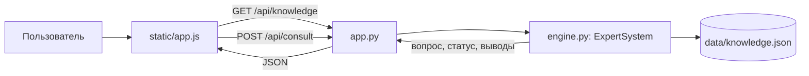

# Руководство разработчика: экспертная система диагностики автомобиля

Это руководство описывает **текущую реализацию** проекта. Начните с разделов «Быстрый запуск» и «Один проход консультации», затем разберите формат правил и функции `engine.py`. Приложение учебное: его вывод — гипотеза по наблюдаемым признакам, а не подтверждённый диагноз автомобиля.

## 1. Что такое экспертная система в этом проекте

Экспертная система хранит знания предметной области отдельно от механизма, который их применяет. Здесь знания записаны в `data/knowledge.json` как продукционные правила вида **ЕСЛИ условия, ТО факт или возможная причина**. `engine.py` принимает ответы пользователя, проверяет правила и выбирает следующий вопрос. `app.py` передаёт запросы между браузером и движком, а `static/` отображает диалог и базу знаний.

Основные термины:

| Термин | Значение здесь |
| --- | --- |
| Факт | Известное системе значение: выбранная жалоба, ответ на вопрос или факт, полученный из промежуточного правила. |
| Рабочая память | Словарь `facts`, создаваемый заново при каждом вызове `consult()`. |
| База знаний | Категории, вопросы, правила и ограничения в `knowledge.json`. |
| Продукция | Правило с условием `if` и следствием `then`. |
| Прямой вывод | Последовательное применение правил к известным фактам до тех пор, пока новые факты не перестанут появляться. |
| Объяснение | Номер сработавшего правила и ответы, относящиеся к его условиям. |

Это **система на продукционных правилах с динамическим выбором вопросов**. Она не обучается на примерах, не вычисляет вероятность поломки и не является строгим бинарным деревом решений. Один ответ может влиять на несколько правил, а несколько правил могут дать разные гипотезы одновременно.

## 2. Быстрый запуск и структура файлов

Требуется Python 3.10 или новее. Сторонние пакеты, сборщик фронтенда и база данных не нужны.

```bash
cd auto_expert
python3 app.py
```

Откройте `http://127.0.0.1:8000/`. Для другого порта: `python3 app.py --port 8001`. В Windows можно использовать `py app.py`. Остановить сервер — `Ctrl+C`.

```text
auto_expert/
├── app.py                 # HTTP-сервер и API
├── engine.py              # вывод, проверка ответов, выбор вопроса
├── rule_editor.py         # проверка и атомарное сохранение правил
├── data/knowledge.json    # база знаний
├── static/index.html      # каркас интерфейса
├── static/app.js          # состояние диалога и графа
├── static/style.css       # оформление и адаптивность
├── tests/test_system.py   # модульные и HTTP-проверки
├── tests/scenarios.json   # контрольные диалоги
├── tests/results.json     # результаты последнего запуска сценариев
└── docs/                  # отчёты и документация
```

На момент составления руководства база содержит **10 категорий, 61 вопрос, 60 правил** (14 промежуточных и 46 конечных) и 3 ограничения на противоречивые ответы. Номера правил 1–60 соответствуют учебной базе из лабораторной 2.

## 3. Как связаны компоненты



При старте `app.py` создаёт `RuleStore`, который загружает JSON и объект `ExpertSystem`. После редактирования правила хранилище атомарно записывает новый JSON и подменяет объект системы, поэтому следующий запрос уже использует новые знания. Сервер слушает только `127.0.0.1`. Он не хранит отдельные пользовательские сессии: каждый запрос консультации содержит выбранную категорию и **все ответы, накопленные в браузере**. Это позволяет безопасно пересчитать вывод после возврата к предыдущему вопросу.

`GET /api/knowledge` отдаёт данные для стартового экрана и графа. `POST /api/consult` вызывает `ExpertSystem.consult()` и возвращает для каждого вывода `trace` — фактически подтверждённую цепочку ответов и правил. Граф в интерфейсе сейчас доступен только для просмотра; методы `POST`, `PUT` и `DELETE` для `/api/rules` остаются в серверном API и передают изменения в `RuleStore`. Статические файлы сервер отдаёт только по явно разрешённым путям `/`, `/style.css` и `/app.js`.

## 4. Формат базы знаний

Корневой объект `knowledge.json` содержит `version`, `scope`, `categories`, `questions`, `rules` и `constraints`.

### Категории

Категория соответствует основной жалобе. У неё есть `id`, заголовок `title` и описание `description`. Например, `start` означает «Двигатель не запускается». Выбранная категория попадает в рабочую память как `complaint = "start"`. Движок рассматривает только правила и вопросы этой категории.

### Вопросы

У вопроса есть `id`, `category`, `text`, `hint`, `priority` и варианты `options`. Вариант хранит машинное `value` и понятное пользователю `label`. Значения могут быть строками или булевыми. Ответ `null` интерфейс использует для «Не знаю»; это отсутствие сведений, а не ответ «Нет».

Необязательное поле `gate` — условие показа вопроса. Например, вопрос о щелчке стартера имеет смысл только после ответа, что стартер не вращается. `priority` задаёт порядок вопросов: меньшее число идёт раньше.

### Правила и условия

Каждое правило содержит `id`, `category`, `type`, `if`, `then` и человекочитаемый `text`. Вложенные условия задаются объектами:

```json
{"all": [{"field": "starter", "eq": "none"}, {"field": "dashboard_off", "eq": true}]}
```

`all` означает логическое **И**, `any` — **ИЛИ**. Лист `{"field":"starter","eq":"none"}` сравнивает значение факта `starter` с `none`. Формат поддерживает вложенность `all`/`any`, хотя текущие верхние условия всех 60 правил используют `all`.

Следствие промежуточного правила имеет вид `{"fact":"no_rotation"}`. Оно добавляет в рабочую память новый факт `no_rotation = true`; само по себе оно не является диагнозом. Конечное правило содержит `conclusion` и `component`, например возможную причину и связанный узел автомобиля. У одного конечного правила также есть `kind: "normal_variant"` для обычного явления, которое не следует называть неисправностью.

В условии можно ссылаться на факт, созданный другим правилом. Так получается цепочка:

```text
жалоба start → правило №1: start_branch
ответ starter = none + start_branch → правило №2: no_rotation
ответ dashboard_off = true + no_rotation → правило №3: возможна проблема с аккумулятором
```

`constraints` перечисляет известные противоречия между ответами. Если условие ограничения истинно, консультация прерывается ошибкой с пояснением. Эти ограничения не создают диагностических фактов. Они охватывают только явно заданные случаи, а не все физически невозможные сочетания.

## 5. Один проход консультации

Браузер начинает с `POST /api/consult` и телом `{"category":"start","answers":{}}`. Затем после каждого ответа отправляет тот же объект со всеми накопленными ответами.

Последовательность `ExpertSystem.consult(category, answers)`:

1. `validate_answers()` проверяет категорию, принадлежность каждого вопроса категории, точный тип и допустимость значения. Для `null` проверка варианта пропускается. Затем проверяются `constraints`.
2. Создаётся словарь `facts = {"complaint": category, **answers}`. Он живёт только в рамках этого запроса.
3. Движок просматривает правила выбранной категории. Истинное правило записывается в `fired_rules`; промежуточное правило добавляет свой факт в `facts`. Проходы повторяются, пока не перестают появляться новые промежуточные факты. Это **прямой вывод**.
4. Для каждого конечного правила `expand()` подставляет условия правил, производящих его промежуточные факты. Если развернутое условие ещё может стать истинным при известных ответах, правило остаётся кандидатом; если уже ложно, исключается.
5. По оставшимся кандидатам собираются нужные поля. Из них выбираются ещё не заданные вопросы, чьи `gate` уже истинны. Сортировка: сначала `priority`, затем число оставшихся правил, где встречается вопрос. Это детерминированная эвристика, не расчёт вероятности и не информационная энтропия.
6. Все сработавшие конечные правила превращаются в `results`. Для каждого добавляются номер, текст, компонент и известные ответы, участвующие в развернутом условии. Движок может продолжить задавать вопросы даже после первого результата, чтобы найти другие совпадающие правила.

Трёхзначная логика нужна, чтобы не путать неизвестность с отрицанием:

| Условие | Результат |
| --- | --- |
| Факт известен и равен ожидаемому | `True` |
| Факт известен и отличается | `False` |
| Факт отсутствует или равен `null` | `None` — пока неизвестно |
| `all`: хотя бы одно `False` | `False` |
| `all`: нет `False`, но есть `None` | `None` |
| `any`: хотя бы одно `True` | `True` |
| `any`: нет `True`, но есть `None` | `None` |

Таким образом, «Не знаю» обычно сохраняет правило среди возможных, а уверенный несовпадающий ответ отсекает его. Неизвестный ответ может привести к статусу `insufficient`, если доступных уточняющих вопросов больше нет.

### Пример по шагам

Пользователь выбирает «Двигатель не запускается» и отвечает `starter = "none"`. Срабатывает промежуточное правило №1 по жалобе, затем №2 по отсутствию вращения. Правила, требующие медленного или нормального вращения, становятся ложными. Если затем `dashboard_off = true`, срабатывает конечное правило №3. Если у других возможных правил остаются незаданные признаки, система продолжит опрос. Возврат и изменение `starter` пересчитают все факты с нуля; старый `no_rotation` не сохранится.

## 6. Статусы и контракт API

### `GET /api/knowledge`

Возвращает `categories`, `questions`, `rules`, `rule_count`, `version` и `revision`. Этот ответ нужен клиенту для списка жалоб и графа. `revision` — SHA-256 текущего файла знаний; он меняется после изменения правила через API. Данные загружаются при открытии страницы.

### `POST /api/consult`

Пример запроса:

```json
{"category":"start","answers":{"starter":"slow"}}
```

Ответ содержит:

| Поле | Назначение |
| --- | --- |
| `category` | Объект выбранной категории. |
| `status` | `question`, `matched`, `insufficient` или `no_match`. |
| `question` | Следующий вопрос либо `null`. |
| `results` | Массив сработавших конечных правил с объяснениями. |
| `fired_rules` | Номера всех сработавших правил, включая промежуточные. |
| `pending_rule_ids` | Ещё возможные, но не сработавшие конечные правила. |
| `remaining_candidates` | Число конечных правил, не исключённых известными ответами. |
| `history` | Переданные ответы в форме для интерфейса. |
| `message` | Краткое описание состояния. |

`question` означает, что есть следующий вопрос; он имеет приоритет даже если часть результатов уже найдена. `matched` означает, что вопросов больше нет и есть хотя бы один вывод. `insufficient` означает, что вопросы закончились, но остались правила с неизвестными условиями и нет подтверждённого вывода. `no_match` означает, что подтверждённых и ещё возможных конечных правил нет. `no_match` не означает исправность автомобиля.

Некорректный JSON, чужой вопрос, недопустимый ответ, неизвестная категория или заданное ограничение приводят к HTTP 400 с JSON-полем `error`. Неизвестный путь даёт HTTP 404. Тело POST ограничено 65 536 байтами.

### Редактирование правил

| Метод и путь | Действие | Тело JSON |
| --- | --- | --- |
| `POST /api/rules` | Добавить правило | `{"revision":"...","rule":{...}}` |
| `PUT /api/rules/<id>` | Изменить правило с тем же номером | `{"revision":"...","rule":{...}}` |
| `DELETE /api/rules/<id>` | Удалить правило | `{"revision":"..."}` |

Успешный ответ имеет тот же формат, что `GET /api/knowledge`, с новым `revision`. Сервер отвечает HTTP 409, если клиент передал устаревшую ревизию или файл на диске изменился вне приложения. Ошибки правила и попытка удалить промежуточное правило с зависимыми правилами дают HTTP 400. Для изменения нужны `Content-Type: application/json`; при наличии заголовка `Origin` он должен указывать на локальное приложение. Новые правила применяются без перезапуска сервера.

`rule_editor.py` проверяет уникальность номеров правил и промежуточных фактов, принадлежность вопросов категории, допустимость значений, форму `all`/`any`, тип следствия и отсутствие циклов. Затем записывает временный файл в ту же папку и заменяет им `knowledge.json` через `os.replace()`. Пока запись не прошла проверку, прежняя база и работающий объект системы остаются на месте.

## 7. Как работает браузерный интерфейс

`static/index.html` содержит шапку, контейнер `#app`, сообщение об ошибке и полноэкранный `<dialog>` базы знаний. `static/app.js` хранит текущую категорию, словарь `answers`, последний ответ сервера `state` и флаг `busy`. Флаг защищает от двойной отправки при быстрых кликах.

`home()` строит список жалоб. `start()` и `refresh()` запрашивают консультацию. `answer()` сохраняет ответ и повторяет запрос; при ошибке откатывает добавленный ответ. `back()` удаляет последний ответ и снова вызывает движок. `render()` показывает вопрос или результаты, а `history()` — уже введённые признаки. При перезагрузке страницы состояние опроса сбрасывается: оно находится в памяти JavaScript, не в серверной сессии и не в `localStorage`.

Граф базы знаний строится в `renderRules()`. Для выбранной категории клиент находит ссылки из условий правил на факты, произведённые другими правилами, раскладывает правила по уровням и рисует связи SVG-кривыми в `drawGraphEdges()`. Узел жалобы служит корнем. Поиск приглушает несовпадающие узлы, но не меняет базу знаний. Колесо мыши над графом и кнопки управляют локальным масштабом от 50% до 200%. Граф доступен только для просмотра. **Он показывает зависимости правил, а не все варианты ответов и не фактический порядок вопросов конкретного диалога.** Поэтому линия сама по себе не означает, что правило обязательно сработает: нужно выполнить и остальные условия его карточки.

`static/style.css` задаёт палитру, мобильную компоновку, состояния элементов и полноэкранный режим графа. Интерфейс работает без внешних библиотек.

## 8. Как добавить или изменить знание

Сейчас граф доступен только для просмотра. Знания можно изменить вручную в `data/knowledge.json`; серверный API редактирования правил также сохранён. Рекомендуемый порядок:

1. Выберите существующую категорию либо добавьте новую с уникальным `id`.
2. Добавьте необходимые вопросы с уникальными `id`, вариантами, подсказками и осмысленными `priority`. Если вопрос должен появляться только после конкретного ответа, задайте `gate`.
3. Добавьте промежуточное правило только если его факт действительно повторно используется или помогает описать цепочку. Для факта используйте уникальное имя; не создавайте циклов зависимостей.
4. Добавьте конечное правило с уникальным числовым `id`, `conclusion` и `component`. В `if` используйте существующие вопросы, `complaint` и допустимые промежуточные факты. Не называйте гипотезу подтверждённым диагнозом.
5. Если появились несовместимые комбинации ответов, добавьте явное `constraint` с понятным сообщением.
6. Добавьте контрольный сценарий в `tests/scenarios.json`, обновите числовые ожидания в тестах, если изменилось количество вопросов или правил, и запустите проверки.
7. Если меняли JSON вручную, перезапустите сервер. Изменения через API применяются сразу.

`ExpertSystem._validate()` проверяет уникальность номеров правил и ID вопросов, категории правил, ссылки на вопросы и факты, а также циклы. `rule_editor.validate_rules()` дополнительно проверяет редактируемые правила и их значения. Это **не полная схемная проверка всего JSON**: формат вопросов, `gate`, ограничения и уникальность категорий нужно проверять отдельно при ручном расширении базы. Нельзя полагаться только на успешную загрузку файла.

## 9. Проверка и границы достоверности

Запуск тестов из корня проекта:

```bash
python3 -m unittest discover -s tests -v
```

Тесты проверяют 20 диалогов из `scenarios.json`, различие «Не знаю» и «Нет», ошибки входных данных, противоречия, цепочку промежуточных правил, пересчёт после изменения ответа, HTTP-маршруты и доступность всех 46 конечных правил на допустимых полных наборах ответов. Проверка достижимости перебирает полные наборы значений; она не доказывает, что каждый вывод будет получен в любом реальном пошаговом диалоге с ограничениями `gate`.

`tests/test_system.py` при запуске переписывает `tests/results.json` фактическими результатами сценариев. После тестов проверьте `git diff`, чтобы не включить случайное изменение этого файла. Для локальной проверки HTTP в среде с прокси исключите `127.0.0.1` из проксирования либо временно снимите переменные `HTTP_PROXY`, `HTTPS_PROXY` и `ALL_PROXY`.

Автоматические тесты проверяют логику и контракт, но не клиническую или техническую точность автомобильной диагностики. Отдельно проверьте интерфейс в браузере: выбор жалобы, ответы, возврат, разные статусы, граф, поиск, масштаб и мобильную ширину.

## 10. Что можно улучшить дальше

Следующие шаги для полноценного редактора базы: создание вопросов и категорий, редактирование вложенных групп условий, полная проверка схемы, история изменений и резервные копии. Само перемещение карточки на экране не должно менять смысл правила: условия `if`, следствие `then` и ссылки на промежуточные факты должны редактироваться явно. Для версионирования знаний удобно хранить изменения в Git и запускать контрольные сценарии перед принятием новой версии.

Система не хранит историю консультаций и не обучается на ответах. Рекомендации по ремонту для лабораторной 5 пока не реализованы.
